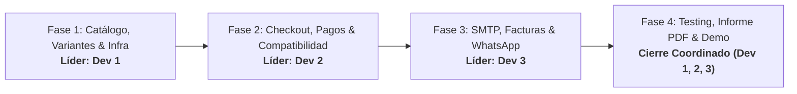

# 📋 Plan de Desarrollo de TechParts - Alineado con Proyecto.md
### Distribución Equitativa para 3 Desarrolladores / Agentes en 4 Fases

Este documento constituye el **Plan Maestro de Desarrollo y Coordinación** para el proyecto **TechParts**. Ha sido rigurosamente auditado y alineado con los requerimientos técnicos y funcionales de [`Proyecto.md`](file:///Users/edissonmorocho/PracticasWeb/techparts/Proyecto.md).

La carga de trabajo se encuentra repartida equitativamente (**33.3% por cada Dev/Agente**) a través de **4 fases secuenciales**, con liderazgo técnico rotativo y criterios de aceptación claros para cada entrega.

---

## 👥 Roles, Especialidades y Asignación de Responsabilidades

| Desarrollador / Agente | Rol Principal | Áreas de Enfoque Principal | Responsabilidades Críticas |
| :--- | :--- | :--- | :--- |
| **Dev 1 (Agente 1)** | **Tech Lead & Database / Infra Architect** | PostgreSQL, Docker Compose, Prisma ORM, Infraestructura, SMTP Backend | Garantizar persistencia, integridad referencial, transacciones ACID, configuración segura de servidor de correos SMTP y orquestación con Docker. |
| **Dev 2 (Agente 2)** | **Fullstack Engineer & Business Logic** | Node.js, Express, Lógica Transaccional, Zod, Variantes de Producto, Pagos | Implementar la lógica transaccional de stock por variantes, validaciones de checkout, pasarelas de pago (transferencia/contra entrega) y envíos. |
| **Dev 3 (Agente 3)** | **Frontend Lead & UI/UX / Customer Experience** | React 18, Vite, TypeScript, Tailwind CSS, Google Stitch, WhatsApp | Diseñar e implementar interfaces modernas, botón y flujo de WhatsApp (`wa.me/`), avisos de compatibilidad, catálogo reactivo y experiencia de checkout. |

---

## 🔄 Matriz de Liderazgo y Fases del Proyecto

---

## 📅 Desglose Detallado por Fases

---

### 🟢 FASE 1: Fundaciones, Arquitectura, Catálogo & Variantes de Producto
> **Líder de Fase**: **Dev 1**  
> **Objetivo**: Establecer el entorno de ejecución, persistencia en base de datos con Docker Compose, arquitectura de catálogo con soporte para productos simples y variables (control de stock independiente por variación) y fundaciones de diseño.

#### 📌 Asignación Equitativa de Tareas:
- **Dev 1 (Líder - Infraestructura, Base de Datos & Modelado)**:
  - [x] Configurar [`docker-compose.yml`](file:///Users/edissonmorocho/PracticasWeb/techparts/docker-compose.yml) con PostgreSQL 16 Alpine, volumen persistente `techparts_pgdata` y healthcheck con `pg_isready`.
  - [x] Diseñar el esquema en [`schema.prisma`](file:///Users/edissonmorocho/PracticasWeb/techparts/backend/prisma/schema.prisma) incorporando:
    - Entidad `Category` (mínimo 3 categorías: Procesadores, Tarjetas Gráficas, Almacenamiento SSD, etc.).
    - Entidad `Product` y soporte para **Variantes de Producto** (`ProductVariant`: capacidad, modelo, color, precio y stock específico por variante).
    - Entidad `InventoryTransaction` para trazabilidad de stock por variante.
  - [x] Configurar variables de entorno globales en `.env.example`.
  - [x] Validar migraciones automáticas y persistencia de datos ante reinicios de contenedor.

- **Dev 2 (Backend Core, Seed & Ingesta de Catálogo)**:
  - [ ] Inicializar el servidor Express con TypeScript en [`backend/`](file:///Users/edissonmorocho/PracticasWeb/techparts/backend).
  - [ ] Preparar el catálogo inicial en [`data/initial_inventory.csv`](file:///Users/edissonmorocho/PracticasWeb/techparts/data/initial_inventory.csv) con al menos 10 productos realistas distribuidos en más de 3 categorías con sus respectivas variantes (ej. SSD 1TB/2TB, GPUs 12GB/16GB).
  - [ ] Desarrollar el script de carga masiva y migración [`seed.ts`](file:///Users/edissonmorocho/PracticasWeb/techparts/backend/prisma/seed.ts).
  - [ ] Implementar middleware global de manejo de excepciones y validación de tipos con Zod.

- **Dev 3 (Frontend Setup, Tokens Stitch & Vistas Base)**:
  - [ ] Inicializar el frontend React 18 + Vite + TypeScript en [`frontend/`](file:///Users/edissonmorocho/PracticasWeb/techparts/frontend).
  - [ ] Configurar la paleta de colores y componentes atómicos basados en **Google Stitch** y Material Design 3.
  - [ ] Crear componentes reutilizables: `Button`, `Badge`, `Card`, `Input`, `Modal` y `Table`.
  - [ ] Diseñar la estructura de navegación con Header, Sidebar y monitor de estado de conexión.

#### ✅ Criterios de Aceptación (DoD Fase 1):
1. El contenedor PostgreSQL inicia saludablemente con `npm run db:up`.
2. Existen al menos 10 productos reales/realistas con variantes y stock independiente cargados en la base de datos.
3. El frontend compila sin errores y expone el sistema de diseño Google Stitch.

---

### 🟡 FASE 2: Métodos de Pago, Zonas de Envío & Aviso de Compatibilidad
> **Líder de Fase**: **Dev 2**  
> **Objetivo**: Implementar la lógica comercial requerida por `Proyecto.md` (mínimo dos formas de pago, zonas de envío geográficas con tarifas, políticas de tienda y el aviso técnico de compatibilidad de componentes PC).

#### 📌 Asignación Equitativa de Tareas:
- **Dev 2 (Líder - Lógica Comercial, Pagos & Envíos)**:
  - [ ] Implementar el servicio de Checkout y Pedidos con soporte para:
    - **Métodos de Pago**: Transferencia bancaria directa y Pago contra entrega (o pasarela Sandbox).
    - **Zonas de Envío**: Configuración de al menos una zona geográfica con método de despacho y tarifa asignada.
    - Definición de moneda (USD/EUR) y cálculo de impuestos básicos.
  - [ ] Crear endpoints para gestión de pedidos y órdenes de compra con transacciones seguras (ACID).
  - [ ] Validar reglas de descuento de stock por cada ítem/variante al completarse una orden.

- **Dev 1 (Motor de Reglas de Compatibilidad & Integridad)**:
  - [x] Diseñar las reglas de compatibilidad de hardware para PC en el backend:
    - Compatibilidad de Socket de CPU con Placa Base (ej. AM5 para Ryzen 7000/8000, LGA1700 para Intel 12-14va gen).
    - Compatibilidad de tipo de memoria (DDR4 vs DDR5).
    - Requerimiento de potencia sugerida de fuente de poder (PSU) según GPU seleccionada.
  - [x] Exponer endpoint `/api/compatibility/check` para validación asistida de compatibilidad entre piezas.

- **Dev 3 (UI de Checkout, Aviso de Compatibilidad & Políticas)**:
  - [ ] Implementar el **Aviso de Compatibilidad en la Tienda** (banner informativo y alertas visuales en ficha de producto para evitar incompatibilidades de socket o potencia).
  - [ ] Diseñar el flujo de Checkout (carrito, selección de zona de envío, método de pago y resumen con desglose de impuestos).
  - [ ] Crear la sección de **Políticas de Envío y Devolución**, información de contacto y términos legales de la tienda TechParts.

#### ✅ Criterios de Aceptación (DoD Fase 2):
1. La tienda cuenta con 2 formas de pago operativas (Transferencia Bancaria y Contra Entrega / Sandbox).
2. Se calculan correctamente las tarifas según la zona de envío seleccionada.
3. El aviso de compatibilidad está visible y funcional en la interfaz de la tienda.

---

### 🔵 FASE 3: Integración SMTP (Facturas y Alertas) & Canal de WhatsApp
> **Líder de Fase**: **Dev 3**  
> **Objetivo**: Desarrollar la integración de WhatsApp para atención previa y compatibilidad, y el sistema de correos transaccionales con SMTP (factura al cliente, alerta de stock bajo al admin y notificación "vuelve a estar disponible").

#### 📌 Asignación Equitativa de Tareas:
- **Dev 3 (Líder - Integración de WhatsApp & Experiencia de Usuario)**:
  - [ ] Implementar el **Botón de Chat de WhatsApp**:
    - Botón flotante accesible en todo el sitio y enlace en cabecera/pie.
    - Botón obligatorio de **"Consulta técnica de compatibilidad"** directamente en la ficha de cada producto.
    - Formato de URL estándar: `https://wa.me/{numero_internacional}?text={mensaje_precargado}`.
    - Mensaje precargado dinámico: `"Hola TechParts, deseo consultar la compatibilidad técnica del producto: [Nombre/SKU del componente]"`.
  - [ ] Mostrar en lugar visible y destacado el **Horario de Atención Técnica** al cliente.
  - [ ] Diseñar el modal/formulario de suscripción para clientes: *"Notificarme cuando este producto vuelva a estar disponible"*.

- **Dev 1 (Infraestructura SMTP & Plantillas de Correo Transaccional)**:
  - [ ] Configurar el servicio de envío de correos vía **SMTP** (utilizando Nodemailer / WP Mail SMTP con Mailtrap para pruebas locales o Brevo/Gmail con credenciales seguras vía `.env`).
  - [ ] Prohibir terminantemente el uso de la función insegura `mail()` de PHP/Node nativo.
  - [ ] Diseñar las **Plantillas de Correo HTML personalizadas** con la identidad de TechParts (logotipo, colores institucionales y pie de página):
    - Correo transaccional de **Pedido Recibido** y **Factura Digital adjunta**.
    - Correo de notificación de **"Nuevo Pedido"** para el administrador.

- **Dev 2 (Lógica de Automatización de Alertas & Notificaciones de Reposición)**:
  - [ ] Implementar la **Alerta Automática de Stock Bajo** para el Administrador: cuando una transacción reduzca el stock de un producto o variante por debajo de `minStock`, disparar el correo de alerta con detalles del SKU y stock restante.
  - [ ] Implementar la **Notificación de Reposición ("Vuelve a estar disponible")**: cuando se ejecute un ingreso (`IN`) sobre un producto agotado, notificar automáticamente a los clientes suscritos.
  - [ ] Registrar logs de auditoría para cada correo enviado exitosamente.

#### ✅ Criterios de Aceptación (DoD Fase 3):
1. Cada ficha de producto cuenta con botón de WhatsApp con mensaje precargado que incluye el nombre exacto de la pieza.
2. El flujo de compra dispara el correo transaccional con la factura correspondiente.
3. Se verifica la llegada de correos de alerta de stock bajo al administrador y notificación de reposición a clientes en entorno SMTP (Mailtrap/Brevo).

---

### 🟣 FASE 4: Testing Integral, Evidencias, Informe Técnico (PDF) & Demo
> **Líder de Fase**: **Cierre Coordinado y Validación Conjunta**  
> **Objetivo**: Ejecutar pruebas completas del ciclo de compra, auditar accesibilidad y rendimiento, documentar todas las evidencias solicitadas en `Proyecto.md` y preparar la presentación en vivo de 5 a 10 minutos.

#### 📌 Asignación Equitativa de Tareas:
- **Dev 1 (Auditoría Técnica, Backup & Despliegue)**:
  - [ ] Ejecutar pruebas de consistencia transaccional ACID en condiciones de concurrencia de compra.
  - [ ] Preparar el archivo de despliegue y backup (Dump de base de datos PostgreSQL / Export All-in-One WP Migration si aplica).
  - [ ] Redactar la sección del informe sobre **Arquitectura Técnica, Dockerización y Configuración SMTP** (con credenciales ocultas en las capturas).

- **Dev 2 (Pruebas del Ciclo de Compra & Manual de Usuario)**:
  - [ ] Ejecutar y certificar el ciclo de compra completo desde dos perspectivas:
    - Perspectiva del Cliente: selección de producto, consulta de compatibilidad, carrito, checkout, selección de pago y recepción de factura.
    - Perspectiva del Administrador: recepción de pedido, deducción de stock y recepción de alerta de stock bajo.
  - [ ] Elaborar el **Manual Breve de Usuario**: instructivo paso a paso para realizar una compra y para contactar al soporte técnico por WhatsApp.
  - [ ] Redactar la justificación de decisiones comerciales, métodos de pago y zonas de envío para el informe.

- **Dev 3 (Evidencias Visuales, Informe Técnico PDF & Guión de Demo)**:
  - [ ] Tomar y organizar el set completo de **evidencias fotográficas**:
    - Capturas del catálogo organizado con sus variantes.
    - Capturas del proceso de checkout y confirmación de pago.
    - Capturas de correos recibidos (factura, stock bajo admin, reposición).
    - Capturas de pantalla de la configuración SMTP (con claves enmascaradas).
    - Capturas del botón de WhatsApp y del chat abierto con el mensaje precargado.
  - [ ] Compilar y formatear el **Informe Técnico Final en formato PDF** cumpliendo con los 5 puntos obligatorios de la sección 5 de `Proyecto.md`.
  - [ ] Diseñar el guión cronometrado para la **Presentación y Demostración en Vivo** (duración: 5 a 10 minutos).

#### ✅ Criterios de Aceptación (DoD Fase 4 - Entrega Final):
1. Informe técnico en PDF completo con todas las justificaciones y capturas de evidencia.
2. Manual breve de usuario integrado y claro.
3. Demostración en vivo preparada y ensayada cubriendo el ciclo completo de compra y llegada de notificaciones.

---

## ⚖️ Matriz de Balance de Carga (33.3% por Desarrollador)

| Fase | Dev 1 (Tech Lead / DB / SMTP) | Dev 2 (Fullstack / Commerce) | Dev 3 (Frontend / UX / WhatsApp) | Total Fase |
| :--- | :---: | :---: | :---: | :---: |
| **Fase 1: Catálogo, Variantes & Infra** | **40% (Líder)** | 30% | 30% | 100% |
| **Fase 2: Pagos, Envíos & Compatibilidad** | 30% | **40% (Líder)** | 30% | 100% |
| **Fase 3: SMTP, Facturas & WhatsApp** | 30% | 30% | **40% (Líder)** | 100% |
| **Fase 4: Testing, Informe PDF & Demo** | 33% | 33% | 34% | 100% |
| **Promedio Global de Esfuerzo** | **~33.3%** | **~33.3%** | **~33.4%** | **100%** |

---

## 📦 Lista de Entregables Obligatorios Compilados

1. **Tienda Funcional**: Código fuente completo y probado con PostgreSQL en Docker Compose, backend transaccional y frontend reactivo con diseño Google Stitch.
2. **Canal de WhatsApp Activo**: Botón general y botón de compatibilidad en cada ficha con mensaje precargado `wa.me/?text=...` y horario de atención.
3. **Flujo SMTP y Correos**: Notificación de factura, alerta de stock bajo al admin y aviso de reposición a clientes con plantillas de marca.
4. **Informe Técnico en PDF**: Justificación técnica de TechParts, decisiones de arquitectura, capturas de catálogo, checkout, SMTP y WhatsApp.
5. **Manual Breve de Usuario**: Guía paso a paso para compras y soporte técnico.
6. **Demostración en Vivo (5-10 min)**: Guión y entorno listo para la defensa del proyecto.
