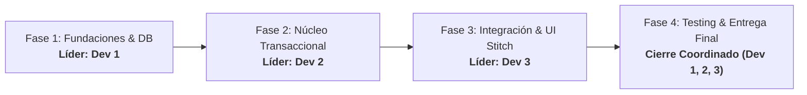

# 📋 Plan de Desarrollo de TechParts - Distribución Equitativa (3 Desarrolladores / Agentes)

Este documento detalla el plan maestro de desarrollo, coordinación y entrega final para el proyecto **TechParts**. La carga de trabajo está repartida equitativamente (33.3% cada uno) entre **3 Desarrolladores / Agentes**, dividiendo las acciones en **4 fases progresivas** basadas en el flujo Kanban.

---

## 👥 Asignación de Roles y Especialidades

| Desarrollador / Agente | Rol Principal | Áreas de Enfoque | Responsabilidad Principal |
| :--- | :--- | :--- | :--- |
| **Dev 1 (Agente 1)** | **Tech Lead & Database / Infra Architect** | Base de Datos, PostgreSQL, Docker, Prisma ORM, Infraestructura | Garantizar persistencia, integridad referencial, transacciones ACID y orquestación con Docker. |
| **Dev 2 (Agente 2)** | **Fullstack Engineer & Business Logic** | Node.js, Express, Lógica Transaccional, Zod, Migración CSV | Implementar las reglas de negocio de stock, validaciones tipadas y migración de datos. |
| **Dev 3 (Agente 3)** | **Frontend Lead & UI/UX Designer** | React 18, Vite, TypeScript, Tailwind CSS, Google Stitch | Crear una interfaz accesible, modular y estética con el sistema de diseño Google Stitch. |

---

## 🔄 Matriz de Liderazgo y Fases del Proyecto

Cada desarrollador asume la **dirección técnica** de una fase, asegurando que todos lideren y colaboren de manera sincronizada sin cuellos de botella:

---

## 📅 Desglose Detallado por Fases

---

### 🟢 FASE 1: Fundaciones, Arquitectura y Base de Datos Relacional
> **Líder de Fase**: **Dev 1**  
> **Objetivo**: Establecer el entorno de desarrollo, la persistencia en PostgreSQL con Docker Compose, el esqueleto del backend y el sistema base de componentes UI en React.

#### 📌 Asignación de Tareas por Desarrollador:
- **Dev 1 (Líder - Infraestructura y DB)**:
  - [x] Configurar `docker-compose.yml` con el servicio `techparts-db` (PostgreSQL 16 Alpine, volumen persistente `techparts_pgdata` y healthcheck con `pg_isready`).
  - [x] Diseñar el esquema declarativo de base de datos en `backend/prisma/schema.prisma`:
    - Modelo `Category` (categorías de componentes).
    - Modelo `Product` (atributos SKU, marca, modelo, precios, stock actual y stock mínimo).
    - Modelo `InventoryTransaction` (auditoría inmutable de ingresos, salidas y ajustes).
    - Modelo `User` (roles y permisos básicos).
  - [x] Configurar las variables de entorno `.env.example` y el script de inicialización de Prisma.
  - [ ] Validar el arranque y conexión exitosa del contenedor PostgreSQL.

- **Dev 2 (Backend Core & Setup)**:
  - [x] Inicializar el proyecto Node.js con TypeScript y Express en `backend/`.
  - [x] Implementar la instancia singleton de Prisma Client en `backend/src/utils/prisma.ts`.
  - [x] Crear el middleware global de manejo de excepciones en `backend/src/middlewares/errorHandler.ts` con soporte para códigos de error de Prisma (P2002, P2025).
  - [x] Implementar el middleware genérico de validación Zod en `backend/src/middlewares/validateRequest.ts`.

- **Dev 3 (Frontend Setup & Tokens de Diseño Stitch)**:
  - [x] Inicializar la aplicación React 18 con Vite y TypeScript en `frontend/`.
  - [x] Configurar Tailwind CSS con los tokens visuales y la paleta de **Google Stitch** (`tailwind.config.js`).
  - [x] Crear los componentes atómicos base:
    - `Button.tsx` (variantes: primary, secondary, danger, outline, ghost).
    - `Badge.tsx` (estados: success, warning, danger, info, neutral).
    - `Card.tsx` (contenedor con sombras y bordes de Google Stitch).
    - `Input.tsx` (campos de formulario accesibles con estados de error).

#### ✅ Criterios de Aceptación (DoD Fase 1):
1. `docker compose up -d` levanta PostgreSQL y responde positivamente al healthcheck en el puerto 5432.
2. `npx prisma db push` o `npx prisma migrate dev` aplica el modelo relacional sin inconsistencias.
3. El frontend compila sin errores y expone los tokens de diseño de Google Stitch.

---

### 🟡 FASE 2: Núcleo de Negocio & APIs Transaccionales ACID
> **Líder de Fase**: **Dev 2**  
> **Objetivo**: Desarrollar la lógica transaccional de control de inventario con garantías ACID, prevenir sobreventas o stocks negativos, y crear los modales interactivos para operar productos y movimientos.

#### 📌 Asignación de Tareas por Desarrollador:
- **Dev 2 (Líder - Lógica de Negocio y Transacciones)**:
  - [x] Implementar `InventoryService.registerMovement` en `backend/src/services/inventory.service.ts`:
    - Ejecución dentro de `prisma.$transaction` para aislamiento transaccional.
    - Validación de stock suficiente para transacciones de salida (`OUT`).
    - Cálculo automático y actualización del estado del producto (`ACTIVE`, `LOW_STOCK`, `OUT_OF_STOCK`).
    - Generación simultánea e inmutable del registro en `InventoryTransaction`.
  - [x] Implementar esquemas de validación Zod para transacciones de stock en `backend/src/routes/inventory.routes.ts`.
  - [x] Implementar el servicio y controlador de categorías (`CategoryService` y `CategoryController`).

- **Dev 1 (Arquitectura de Datos y APIs de Consulta)**:
  - [x] Implementar `ProductService` con filtros multi-criterio (búsqueda por texto en SKU/nombre/marca, filtro por categoría, filtro por estado y paginación).
  - [x] Crear los controladores REST `ProductController` para operaciones CRUD completas.
  - [x] Crear el servicio de métricas financieras de inventario `InventoryService.getDashboardMetrics` (cálculo de stock físico total, valoración al costo y a precio de venta).

- **Dev 3 (Formularios y Modales Interactivos en Frontend)**:
  - [x] Crear el componente modal accesible `Modal.tsx` con soporte para cierre mediante tecla `Escape` y backdrop blur.
  - [x] Implementar `ProductModal.tsx` para dar de alta nuevos productos y editar especificaciones técnicas.
  - [x] Implementar `StockMovementModal.tsx` con cálculo dinámico en tiempo real del stock proyectado antes de confirmar la transacción.

#### ✅ Criterios de Aceptación (DoD Fase 2):
1. No es posible ejecutar una salida de stock si la cantidad solicitada supera el stock físico existente (retorna HTTP 400 descriptivo).
2. Cada transacción de inventario actualiza el stock del producto y crea una fila de auditoría de forma atómica.
3. Los modales del frontend validan tipos y datos antes de enviar la petición.

---

### 🔵 FASE 3: Integración Full-Stack, Dashboards, Filtros y Migración CSV
> **Líder de Fase**: **Dev 3**  
> **Objetivo**: Integrar completamente el frontend con la API, construir las vistas del Dashboard con KPIs financieros, tabla de inventario con filtros en vivo y ejecutar la migración inicial de datos desde Google Sheets / CSV.

#### 📌 Asignación de Tareas por Desarrollador:
- **Dev 3 (Líder - Vistas de Usuario e Integración UI)**:
  - [x] Construir la página `DashboardPage.tsx`:
    - 4 Tarjetas de KPIs (Catálogo de SKUs, Unidades en Almacén, Alertas de Stock, Valoración Estimada).
    - Lista destacada de componentes en stock crítico con botón rápido de reabastecimiento.
  - [x] Construir la página `InventoryPage.tsx`:
    - Barra de búsqueda en tiempo real con debounce y filtros combinados (categoría y estado).
    - Tabla interactiva con badges de estado, precios, stocks y acciones rápidas (movimiento, edición, eliminación).
  - [x] Construir la página `MovementsPage.tsx` para visualizar el libro histórico de auditoría.
  - [x] Implementar `Header.tsx` con indicador en vivo del estado de conexión a PostgreSQL.

- **Dev 2 (Migración de Datos y Conectores de Red)**:
  - [x] Crear el archivo de datos semilla `data/initial_inventory.csv` con especificaciones reales de componentes (CPUs AMD/Intel, GPUs RTX/Radeon, Memorias DDR5, Placas Base, SSDs NVMe y Fuentes 80+ Gold).
  - [x] Desarrollar el script de seed automatizado `backend/prisma/seed.ts` utilizando streaming (`csv-parser`) para procesar el CSV y poblar PostgreSQL con transacciones iniciales.
  - [x] Configurar el cliente HTTP centralizado con Axios en `frontend/src/api/apiClient.ts` con manejo unificado de errores y timeouts.

- **Dev 1 (Monitoreo, Healthcheck & Diagnóstico)**:
  - [x] Implementar el endpoint `GET /api/health` en `backend/src/controllers/health.controller.ts` ejecutando `SELECT 1` para medir la latencia real de respuesta de PostgreSQL.
  - [x] Desarrollar la página `SettingsPage.tsx` en el frontend para visualización del estado del servicio, latencia de base de datos y comandos rápidos.
  - [x] Configurar políticas de CORS restrictivas pero configurables vía variables de entorno.

#### ✅ Criterios de Aceptación (DoD Fase 3):
1. `npm run db:seed` importa satisfactoriamente todos los registros del CSV inicial y genera los movimientos de auditoría correspondientes.
2. El Dashboard muestra KPIs calculados directamente desde la base de datos PostgreSQL.
3. El usuario puede buscar productos y filtrar por categoría con respuesta fluida e inmediata.

---

### 🟣 FASE 4: Testing, Auditoría de Calidad, Despliegue y Entrega Final
> **Líder de Fase**: **Cierre Coordinado y Validación Conjunta**  
> **Objetivo**: Ejecutar pruebas de carga/concurrencia, auditoría de accesibilidad, validación cruzada y empaquetado final para la entrega.

#### 📌 Asignación de Tareas por Desarrollador:
- **Dev 1 (Pruebas de Estrés Transaccional & Persistencia)**:
  - [ ] Ejecutar pruebas de concurrencia simulando múltiples compras simultáneas sobre un mismo SKU para verificar que PostgreSQL y `prisma.$transaction` eviten condiciones de carrera (*race conditions*).
  - [ ] Verificar la persistencia del volumen Docker `techparts_pgdata` al reiniciar o recrear los contenedores.
  - [ ] Elaborar la guía de respaldo y restauración (*backup & restore*) de la base de datos PostgreSQL.

- **Dev 2 (Pruebas de Integración de API & Calidad de Código)**:
  - [ ] Validar cobertura de pruebas de los endpoints de productos, inventario y categorías.
  - [ ] Comprobar que todas las respuestas de error sigan el formato estándar `{ success: false, message: string }`.
  - [ ] Ejecutar análisis estático de código (`npm run build` en backend) verificando 0 advertencias o errores de tipado TypeScript.

- **Dev 3 (Auditoría A11y, Performance & Pulido Stitch)**:
  - [ ] Ejecutar auditoría de accesibilidad (a11y) verificando contraste de color WCAG AA en badges y botones, etiquetas semánticas y navegación por teclado.
  - [ ] Verificar adaptabilidad responsive completa (móvil, tablet y pantallas de escritorio).
  - [ ] Ejecutar build de producción en frontend (`npm run build`) verificando optimización de bundles y cero errores.

#### ✅ Criterios de Aceptación (DoD Fase 4 - Entrega Final):
1. Build exitoso en backend (`npm run build:backend`) y frontend (`npm run build:frontend`).
2. Persistencia verificada de datos tras `docker compose down` y `docker compose up -d`.
3. Documentación completa con instrucciones paso a paso para evaluación o despliegue.

---

## ⚖️ Balance Equitativo de Esfuerzo (33.3% por Dev)

| Desarrollador | Fase 1 | Fase 2 | Fase 3 | Fase 4 | Esfuerzo Total |
| :--- | :---: | :---: | :---: | :---: | :---: |
| **Dev 1 (Tech Lead / DB)** | **40% (Líder)** | 30% | 25% | 35% | **~33.3%** |
| **Dev 2 (Fullstack / Logic)** | 30% | **45% (Líder)** | 30% | 30% | **~33.3%** |
| **Dev 3 (Frontend / Stitch)** | 30% | 25% | **45% (Líder)** | 35% | **~33.3%** |

---

## 🌿 Convención de Ramas Git y Flujo de Trabajo

Para evitar conflictos entre los desarrolladores, se adopta el siguiente flujo de ramas:

- `main`: Código estable de producción.
- `develop`: Rama de integración donde convergen las fases.
- **Ramas por Desarrollador y Tarea**:
  - `dev1/fase1-docker-prisma-db`
  - `dev2/fase2-acid-stock-services`
  - `dev3/fase3-stitch-dashboard-ui`
  - `dev1/fase4-acid-stress-testing`
  - `dev2/fase4-api-integration-qa`
  - `dev3/fase4-a11y-frontend-build`

---

## 🏁 Resumen de Entregables Finales
1. Contenedor PostgreSQL orquestado vía Docker Compose con datos persistentes.
2. Microservicio backend modular con endpoints REST, validación Zod y transacciones ACID.
3. Frontend interactivo y reactivo diseñado con tokens de Google Stitch y Tailwind CSS.
4. Datos iniciales migrados desde `data/initial_inventory.csv` con historial de auditoría.
5. Plan de desarrollo y coordinación técnica para los 3 desarrolladores documentado en `PLAN-DESARROLLO.md`.
